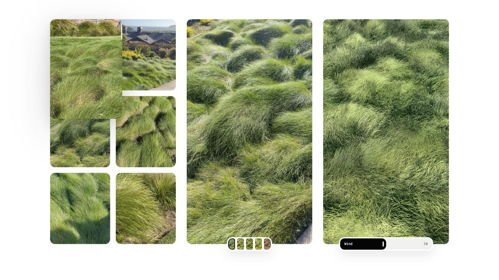

# Grass Shader

A real-time WebGL2 study of ornamental grass moving in coastal wind, paired with the original reference recordings. Fine grass blades, layered gusts, and carefully placed mounds are rendered procedurally.

The project includes a desktop web demo and a native iPhone app with bundled footage and an offline copy of the shader.



## Run on your computer

Install **Node.js 22.13 or newer** (Node 22 LTS recommended), then:

```sh
git clone https://github.com/MarvinSchwaibold/grass-shader.git
cd grass-shader
npm ci
npm run dev
```

Open **http://localhost:5207/demo-one**.

| Route | View |
| --- | --- |
| `/` | Demo links |
| `/demo-one` | Six recordings, reference media, and the live shader |
| `/demo-two` | Reference media and the live shader |

Use the wind slider to change the wind. Select a reference thumbnail to switch between footage and derived maps. Select a recording to expand it; Escape closes it on desktop.

No API keys, account, database, or environment file are needed. Media is included in the repository; the initial clone is larger than a code-only project.

## Run on your phone

**Native iPhone app — the complete phone experience:**

1. On a Mac with Xcode 16 or newer, open `ios/GrassStudyFluidDemo/GrassStudyFluidDemo.xcodeproj`.
2. Let Xcode resolve the pinned Wave package.
3. Select the `GrassStudyFluidDemo` scheme and an iPhone simulator, then press **Run**.
4. For a physical iPhone (iOS 17+), select your own Team under **Signing & Capabilities**, use a unique bundle identifier, and select your connected phone. Enable Developer Mode on the phone if Xcode requests it.

The app has three swipeable pages: recordings, reference media, and the shader. It runs offline after installation. You do **not** need to run the web server or install Node to launch the checked-in iPhone app.

See [the iPhone guide](ios/README.md) for device setup, bundle updates, and troubleshooting.

**Quick browser preview on a phone:**

```sh
npm run dev:phone
```

Connect the computer and phone to the same trusted Wi-Fi network. Open `http://YOUR_COMPUTER_LAN_IP:5207/demo-two` on the phone. Use the computer's LAN address, not `localhost`. This is the responsive web comparison; the native app provides the dedicated full-screen paging experience. The server is reachable on your local network until you stop it with Ctrl+C.

## Work on the project

| Command | Purpose |
| --- | --- |
| `npm run dev` | Desktop development on port 5207 |
| `npm run dev:phone` | Development accessible on your local network |
| `npm run build` | Production web build |
| `npm start` | Serve the production build on port 5207 |
| `npm run typecheck` | TypeScript checks |
| `npm run lint` | Source lint checks |
| `npm test` | Build and test production routes and video delivery |
| `npm run check` | Typecheck, lint, build, and tests |
| `npm run ios:sync` | Build web source and refresh the bundled iPhone shader |

The web stack is React, TypeScript, and vinext/Vite. WebGL2 is required. Native presentation uses SwiftUI, AVPlayer, WKWebView, and Wave.

## Project map

- `app/OrnamentalGrass.tsx` — shader code, deterministic blade placement, wind, recordings, and interactions.
- `app/globals.css` — web layout and presentation.
- `app/demo-one/`, `app/demo-two/` — demo routes.
- `public/` — footage, textures, and reference maps.
- `ios/GrassStudyFluidDemo/` — native iPhone project and bundled web snapshot.
- `ios/phone-overrides.css` — source CSS for the native shader page.
- `scripts/` — production preview and iPhone bundle tooling.
- `tests/` — production smoke tests.
- [AGENTS.md](AGENTS.md) — setup, architecture, validation, and visual constraints for coding agents.

## Troubleshooting

- **Port 5207 is busy:** stop the earlier server or use `npm run dev -- -p 5208`.
- **Videos are blank or stopped:** reload the tab, confirm the `.mp4` requests succeed, and keep the tab visible. Browsers may suspend background media.
- **Shader is blank:** use a browser with WebGL2 and hardware acceleration enabled. Check its console for shader errors.
- **Phone cannot reach the computer:** check the LAN IP, shared Wi-Fi, and firewall permission. Guest networks may isolate devices.
- **Changes are missing from the iPhone app:** run `npm run ios:sync`, then rebuild in Xcode. The app does not load your dev server.

See [dependency maintenance notes](docs/DEPENDENCIES.md) for the remaining upstream audit advisories.

This repository contains the restored original grass study. Experimental Blender terrain replacements are not part of the running demo.
